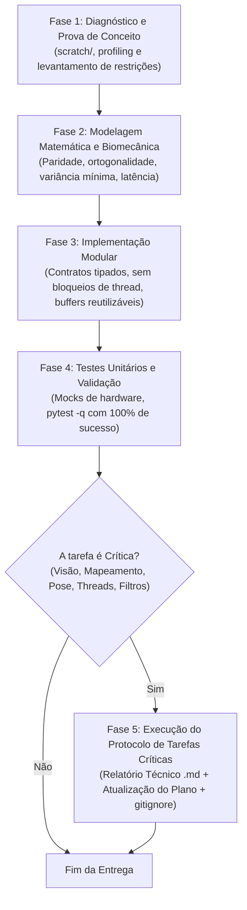

# Diretrizes para Agentes de I.A. — L.O.R.E.N.A.-DESKTOP
**Guia Operacional de Engenharia, Pipeline de Features, Revisão de Código e Protocolo de Tarefas Críticas**

---

## 1. Missão e Princípios Fundamentais

O **L.O.R.E.N.A.-DESKTOP** é uma aplicação de acessibilidade motora assistiva para desktop Windows (com suporte futuro multiplataforma) que converte o rastreamento ocular e de cabeça, associado a gestos faciais (piscadas e permanência), em controle fluído e de alta precisão do cursor do mouse, sem depender de hardware óptico proprietário caro.

### Metas de Qualidade Inegociáveis (SLAs do Sistema)
Qualquer agente atuando nesta base de código deve respeitar e manter as seguintes métricas:

| Métrica | Limite Crítico | Meta Alvo | Método de Verificação |
|---|---|---|---|
| **Taxa de Quadros (Pipeline)** | $\ge 25$ FPS | $\mathbf{\ge 30}$ **FPS** | Timestamp entre frames capturados no `TrackingPipeline` |
| **Latência End-to-End** | $< 50$ ms | $\mathbf{< 35}$ **ms** | Intervalo entre a captura do frame e o envio ao Win32 |
| **Desvio Médio de Calibração** | $< 45$ px | $\mathbf{< 30}$ **px** | Leave-One-Out (LOO) em tela 15,6" (1080p/768p) |
| **Estabilidade em Fixação (Jitter)**| $< 10$ px RMS | $\mathbf{< 5}$ **px RMS** | Desvio padrão da posição ancorada em repouso |
| **Acurácia em Micro-Alvos** | $\ge 90\%$ | $\mathbf{\ge 98\%}$ | Sucesso de clique com Lupa Inteligente (Zoom-and-Click) |
| **Integridade da Suíte de Testes** | 100% | **100%** | Todos os testes em `pytest` sem falhas e sem testes ignorados |

---

## 2. Arquitetura e Limites de Concorrência

O projeto segue princípios estritos de **Domain-Driven Design (DDD)** e **Clean Architecture**:

```
lorena/
├── domain/models.py         # Entidades puras e imutáveis (@dataclass(frozen=True)). Sem I/O nem OpenCV.
├── config.py                # Dataclasses tipadas de configuração com persistência JSON atômica.
├── vision/
│   ├── camera.py            # I/O assíncrono em thread dedicada, backend MSMF + fourcc MJPG.
│   ├── face_detector.py     # Wrapper puro do MediaPipe Tasks FaceLandmarker.
│   ├── gaze_features.py     # Extração de vetores oculares, fusão 5-pontos de íris.
│   ├── illumination.py      # Normalização de luz, bypass dinâmico (0,5 ms) e gama contínuo.
│   ├── blink_detector.py    # Máquina de estados finitos (FSM) de EAR para piscadas.
│   └── exposure.py          # Controle em malha fechada de exposição da webcam.
├── mapping/
│   ├── gaze_mapper.py       # Regressão polinomial simétrica (z|z|), LOO e desacoplamento 2 estágios.
│   ├── geometry.py          # Projeção euclidiana, conversão física deg_to_px via GetDeviceCaps.
│   └── filters.py           # OneEuroFilter2D, OutlierGate, FixationStabilizer, PositionHistory.
├── services/
│   ├── tracking_pipeline.py # Thread dedicada de visão em tempo real (baixa latência).
│   ├── cursor_session.py    # Orquestração do tracking, projeção preditiva cinemática e FSM da lupa.
│   ├── cursor.py            # Win32Cursor direto (SetCursorPos) e RecordingCursor para testes.
│   └── magnifier_controller # Lupa de precisão (Zoom-and-Click) para alvos pequenos.
└── ui/
    ├── main_window.py       # Interface ergonômica em Tkinter rodando na thread principal.
    ├── camera_preview.py    # Feed ao vivo em thread desacoplada sem travar o pipeline.
    ├── calibration_view.py  # Tela cheia de calibração em 2 passes (14 pontos).
    └── magnifier_lens.py    # Overlay circular translúcido com animações cúbicas a 60 FPS.
```

### Regras Mandatórias de Concorrência (Threading)
1. **Thread Principal (Tkinter):** Dedicada exclusivamente ao loop de eventos da interface gráfica (`root.mainloop()`). **NUNCA** execute OpenCV síncrono, inferência de visão, leituras de disco pesadas ou `time.sleep` nesta thread.
2. **Thread de Visão (`TrackingPipeline`):** Executa o ciclo de visão contínuo. Consome frames da câmera de forma não-bloqueante e envia coordenadas para o cursor e eventos para a UI via `queue.Queue` thread-safe.
3. **Thread de Captura de Hardware (`Camera._capture_worker`):** I/O bloqueante de câmera (`cap.read()`) roda isolado em segundo plano, protegendo o buffer atômico com lock e notificando novos frames via `threading.Event`.
4. **Comunicação Segura:** Para atualizar a UI a partir de threads secundárias, use estritamente `root.after()` ou filas de mensagens.

---

## 3. Pipeline de Desenvolvimento de Features

Todo agente de I.A. que implementar novas funcionalidades no L.O.R.E.N.A. deve seguir rigorosamente as 4 fases:



### Fase 1: Diagnóstico e Prova de Conceito
- Identificar gargalos e limites físicos (largura de banda de USB, iluminação, resolução de tela, limites de frequência do olho).
- Prototipar funções e algoritmos experimentais no diretório de rascunhos temporários `scratch/`.
- **Nunca alterar o código de produção antes de provar a hipótese matematicamente.**

### Fase 2: Modelagem Matemática e Biomecânica
- **Preservação de Paridade Simétrica:** Nunca use funções pares puras ($u^2$) para modelar coordenadas que se estendem bilateralmente a partir do centro da tela. Use a base ímpar-simétrica $u \cdot |u|$.
- **Desacoplamento de Pose:** Sempre que adicionar compensação de cabeça, utilize o desacoplamento biomecânico em dois estágios para anular a colinearidade do Reflexo Vestíbulo-Ocular (VOR).
- **Escala Física Angular:** Parâmetros espaciais devem ser parametrizados em graus visuais (`deg_to_px`) calculados a partir das dimensões físicas reais da tela do usuário.

### Fase 3: Implementação Modular Defensiva
- **Zero Alocações Excessivas em Loops a 30 FPS:** Reutilize arrays NumPy e buffers sempre que possível; evite instanciar objetos pesados por frame.
- **Continuidade Visual em Imagens:** Nunca aplique transformações de cor (LUT, brilho, CLAHE) apenas em sub-regiões recortadas de forma a criar bordas retangulares artificiais sobre a face. O MediaPipe detecta essas bordas e sofre jitter.
- **Bypass em Condições Nominais:** Se o sinal de entrada já estiver dentro dos parâmetros normais (ex.: iluminação estável entre 85 e 170 de luminância), faça bypass imediato em $\le 0,5\text{ ms}$.

### Fase 4: Testabilidade e Validação
- Escrever testes automatizados em `tests/` cobrindo o novo comportamento, limites numéricos e casos de borda.
- Rodar a suíte completa com `.venv\Scripts\python -m pytest -q` e garantir 100% de aprovação.

---

## 4. Pipeline de Revisão de Código (Safety Gates)

Antes de considerar qualquer alteração concluída, o agente deve auditar o código contra este checklist:

### Checklist de Revisão Obrigatório
- [ ] **Portão 1: Performance & FPS**
  - O código introduz operações bloqueantes ou demoradas (> 5 ms) dentro do loop de captura ou de visão?
  - A taxa de frames de captura se mantém em $\ge 30$ FPS contínuos?
- [ ] **Portão 2: Rigor Matemático e Biomecânico**
  - Funções de mapeamento respeitam paridade ímpar-simétrica ($z|z|$)?
  - Há colinearidade entre os eixos de cabeça e olho?
  - O sinal da íris utiliza o centroide de 5 landmarks para redução de variância?
- [ ] **Portão 3: Concorrência e Threads**
  - Há compartilhamento de estado mutável sem lock?
  - Métodos da UI Tkinter são invocados estritamente na thread principal?
- [ ] **Portão 4: Compatibilidade de Plataforma e Hardware**
  - Chamadas Win32 (`ctypes`, `GetDeviceCaps`, `SetCursorPos`, `BitBlt`) possuem fallbacks defensivos para ambientes de teste e CI?
  - O OpenCV utiliza `CAP_MSMF` com fourcc `MJPG` para prevenir saturação do barramento USB?
- [ ] **Portão 5: Integridade de Documentação e Testes**
  - Docstrings e comentários explicam o *raciocínio matemático/arquitetural* e não apenas a sintaxe?
  - A suíte de testes passou com 100% de aprovação?

---

## 5. Protocolo Obrigatório para Tarefas Críticas

### 5.1. Definição de Tarefas Críticas
Considera-se **Tarefa Crítica** qualquer alteração ou refatoração envolvendo:
1. Núcleo de Visão Computacional (`lorena/vision/`);
2. Extração de Landmarks, Íris e Expressões Faciais (`face_detector.py`, `landmarks.py`, `gaze_features.py`);
3. Regressão Polinomial, Mapeamento Espacial e Compensação de Cabeça (`lorena/mapping/`);
4. Filtros Temporais, Estabilização e Projeção Cinemática (`filters.py`, `cursor_session.py`);
5. I/O de Câmera, Formatos de Vídeo, Barramento USB e Modelo de Threads (`camera.py`, `tracking_pipeline.py`).

### 5.2. Requisito Obrigatório: Relatório Técnico de Alterações
Sempre que concluir uma Tarefa Crítica, o agente de I.A. **DEVE OBRIGATORIAMENTE**:

1. **Criar ou Atualizar um Relatório Técnico no Diretório `reports/`** (ex.: `reports/RELATORIO_TECNICO_*.md`).
2. **Garantir que o Diretório `reports/` Permaneça no `.gitignore`:**
   - O diretório `reports/` é dedicado exclusivamente a relatórios de engenharia e benchmarks detalhados, mantido no `.gitignore` para evitar poluição do histórico de commits do repositório.
3. **Estrutura Obrigatória do Relatório:**
   - **Diagnóstico das Causas-Raiz:** Demonstração empírica e teórica dos problemas encontrados (gargalos de barramento, degraus de contraste, colinearidade VOR, distorção parabólica, etc.).
   - **Fundamentação Matemática e Biomecânica:** Equações completas, demonstrações de simetria/ortogonalidade e justificativa técnica de por que a solução adotada foi escolhida em detrimento de abordagens ingênuas.
   - **Métricas Comparativas Empíricas:** Tabela com valores numéricos de *Antes vs. Depois* contendo: FPS, consumo de barramento USB (MB/s), tempo de pré-processamento (ms), desvio médio de calibração (px), desvio padrão de jitter e erro angular nos cantos.
   - **Implicações Arquiteturais:** Módulos impactados, garantia de contratos e invariantes mantidos.
4. **Registrar no Plano Contínuo:**
   - Atualizar a tabela de histórico contínuo em [`docs/PLANO_DE_MELHORIAS.md`](file:///C:/Users/Herna/OneDrive/Documentos/workspace/L.O.R.E.N.A.-DESKTOP/docs/PLANO_DE_MELHORIAS.md) com o número da versão, resumo da entrega e contagem exata de testes aprovados.

---

## 6. Anti-Padrões a Evitar Severamente

| Anti-Padrão | Impacto Negativo | Abordagem Correta |
|---|---|---|
| **Variáveis Globais Mutáveis** | Condições de corrida e dados corrompidos entre threads | Estado encapsulado em instâncias com sincronização clara |
| **`cv2.waitKey()` em Thread Secundária** | Consumo incorreto de teclas e travamentos de UI | Manipulação de atalhos via Win32 Hooks ou eventos Tkinter |
| **Máscara Local de Contraste na Face** | Jitter de landmarks do MediaPipe por degrau visual | Gama global contínuo com bypass dinâmico em 0,5 ms |
| **Polinômio Quadrático Par ($h^2$)** | Assimetria nos cantos da tela e erro de calibração | Base ímpar-simétrica com preservação de sinal ($z\|z\|$) |
| **I/O Síncrono de Câmera na Thread de Visão** | Queda brusca da taxa de quadros para 10–14 FPS | Thread dedicada de captura com buffer protegido por lock |
| **Redução Arbitrária de Resolução** | Perda de precisão subpixel nos limites da íris | Manter 720p nativo do MediaPipe com backend MJPG acelerado |
| **Diálogos Modais do SO (`MessageBox`) em Threads de Tempo Real** | Congelamento instantâneo do rastreio ocular | Notificações assíncronas no `StatusOverlay` |
