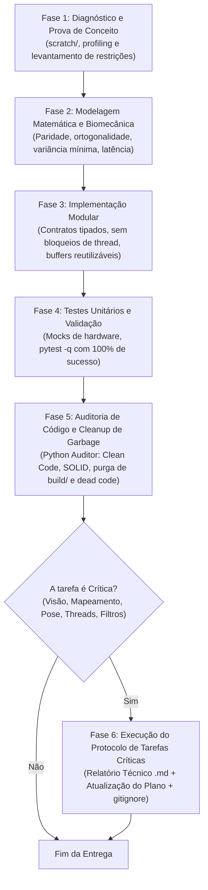
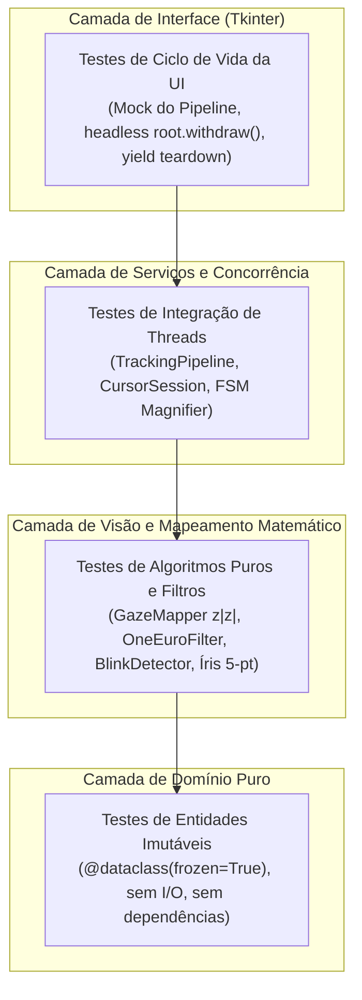

# Diretrizes para Agentes de I.A. — L.O.R.E.N.A.-DESKTOP
**Guia Operacional de Engenharia, Pipeline de Features, Revisão de Código e Protocolo de Tarefas Críticas**

---

## 1. Missão e Princípios Fundamentais

O **L.O.R.E.N.A.-DESKTOP** é uma aplicação de acessibilidade motora assistiva para desktop Windows (com suporte futuro multiplataforma) que converte o rastreamento ocular e de cabeça, associado a gestos faciais (piscadas e permanência), em controle fluído e de alta precisão do cursor do mouse, sem depender de hardware óptico proprietário caro.

### Metas de Qualidade Inegociáveis (SLAs do Sistema)
Qualquer agente atuando nesta base de código deve respeitar e manter as seguintes métricas:

| Métrica | Limite Crítico | Meta Alvo | Método de Verificação |
|---|---|---|---|
| **Taxa de Quadros (Pipeline)** | $\ge 25$ FPS | $\mathbf{\ge 30}$ **FPS** | Timestamp entre frames capturados no `TrackingPipeline` |
| **Latência End-to-End** | $< 50$ ms | $\mathbf{< 35}$ **ms** | Intervalo entre a captura do frame e o envio ao Win32 |
| **Desvio Médio de Calibração** | $< 45$ px | $\mathbf{< 30}$ **px** | Leave-One-Out (LOO) em tela 15,6" (1080p/768p) |
| **Estabilidade em Fixação (Jitter)**| $< 10$ px RMS | $\mathbf{< 5}$ **px RMS** | Desvio padrão da posição ancorada em repouso |
| **Acurácia em Micro-Alvos** | $\ge 90\%$ | $\mathbf{\ge 98\%}$ | Sucesso de clique com Lupa Inteligente (Zoom-and-Click) |
| **Integridade da Suíte de Testes** | 100% | **100%** | Todos os testes em `pytest` sem falhas e sem testes ignorados |

---

## 2. Arquitetura e Limites de Concorrência

O projeto segue princípios estritos de **Domain-Driven Design (DDD)** e **Clean Architecture**:

```
lorena/
├── domain/models.py         # Entidades puras e imutáveis (@dataclass(frozen=True)). Sem I/O nem OpenCV.
├── config.py                # Dataclasses tipadas de configuração com persistência JSON atômica.
├── vision/
│   ├── camera.py            # I/O assíncrono em thread dedicada, backend MSMF + fourcc MJPG.
│   ├── face_detector.py     # Wrapper puro do MediaPipe Tasks FaceLandmarker.
│   ├── gaze_features.py     # Extração de vetores oculares, fusão 5-pontos de íris.
│   ├── illumination.py      # Normalização de luz, bypass dinâmico (0,5 ms) e gama contínuo.
│   ├── blink_detector.py    # Máquina de estados finitos (FSM) de EAR para piscadas.
│   └── exposure.py          # Controle em malha fechada de exposição da webcam.
├── mapping/
│   ├── gaze_mapper.py       # Regressão polinomial simétrica (z|z|), LOO e desacoplamento 2 estágios.
│   ├── geometry.py          # Projeção euclidiana, conversão física deg_to_px via GetDeviceCaps.
│   └── filters.py           # OneEuroFilter2D, OutlierGate, FixationStabilizer, PositionHistory.
├── services/
│   ├── tracking_pipeline.py # Thread dedicada de visão em tempo real (baixa latência).
│   ├── cursor_session.py    # Orquestração do tracking, projeção preditiva cinemática e FSM da lupa.
│   ├── cursor.py            # Win32Cursor direto (SetCursorPos) e RecordingCursor para testes.
│   └── magnifier_controller # Lupa de precisão (Zoom-and-Click) para alvos pequenos.
└── ui/
    ├── main_window.py       # Interface ergonômica em Tkinter rodando na thread principal.
    ├── camera_preview.py    # Feed ao vivo em thread desacoplada sem travar o pipeline.
    ├── calibration_view.py  # Tela cheia de calibração em 2 passes (14 pontos).
    └── magnifier_lens.py    # Overlay circular translúcido com animações cúbicas a 60 FPS.
```

### Regras Mandatórias de Concorrência (Threading)
1. **Thread Principal (Tkinter):** Dedicada exclusivamente ao loop de eventos da interface gráfica (`root.mainloop()`). **NUNCA** execute OpenCV síncrono, inferência de visão, leituras de disco pesadas ou `time.sleep` nesta thread.
2. **Thread de Visão (`TrackingPipeline`):** Executa o ciclo de visão contínuo. Consome frames da câmera de forma não-bloqueante e envia coordenadas para o cursor e eventos para a UI via `queue.Queue` thread-safe.
3. **Thread de Captura de Hardware (`Camera._capture_worker`):** I/O bloqueante de câmera (`cap.read()`) roda isolado em segundo plano, protegendo o buffer atômico com lock e notificando novos frames via `threading.Event`.
4. **Comunicação Segura:** Para atualizar a UI a partir de threads secundárias, use estritamente `root.after()` ou filas de mensagens.

---

## 3. Pipeline de Desenvolvimento de Features

Todo agente de I.A. que implementar novas funcionalidades no L.O.R.E.N.A. deve seguir rigorosamente as 4 fases:



### Fase 1: Diagnóstico e Prova de Conceito
- Identificar gargalos e limites físicos (largura de banda de USB, iluminação, resolução de tela, limites de frequência do olho).
- Prototipar funções e algoritmos experimentais no diretório de rascunhos temporários `scratch/`.
- **Nunca alterar o código de produção antes de provar a hipótese matematicamente.**

### Fase 2: Modelagem Matemática e Biomecânica
- **Preservação de Paridade Simétrica:** Nunca use funções pares puras ($u^2$) para modelar coordenadas que se estendem bilateralmente a partir do centro da tela. Use a base ímpar-simétrica $u \cdot |u|$.
- **Desacoplamento de Pose:** Sempre que adicionar compensação de cabeça, utilize o desacoplamento biomecânico em dois estágios para anular a colinearidade do Reflexo Vestíbulo-Ocular (VOR).
- **Escala Física Angular:** Parâmetros espaciais devem ser parametrizados em graus visuais (`deg_to_px`) calculados a partir das dimensões físicas reais da tela do usuário.

### Fase 3: Implementação Modular Defensiva
- **Zero Alocações Excessivas em Loops a 30 FPS:** Reutilize arrays NumPy e buffers sempre que possível; evite instanciar objetos pesados por frame.
- **Continuidade Visual em Imagens:** Nunca aplique transformações de cor (LUT, brilho, CLAHE) apenas em sub-regiões recortadas de forma a criar bordas retangulares artificiais sobre a face. O MediaPipe detecta essas bordas e sofre jitter.
- **Bypass em Condições Nominais:** Se o sinal de entrada já estiver dentro dos parâmetros normais (ex.: iluminação estável entre 85 e 170 de luminância), faça bypass imediato em $\le 0,5\text{ ms}$.

### Fase 4: Testabilidade e Validação Contínua (Pytest Standard)
- Escrever testes automatizados em `tests/` cobrindo comportamento nominal, limites numéricos, casos de borda e regressão.
- Seguir rigorosamente a arquitetura de testes em camadas, fixtures canônicas em `tests/conftest.py` e asserções com tolerâncias físicas (ver Seção 4).
- Rodar a suíte completa com `.venv\Scripts\python -m pytest -q` e garantir 100% de aprovação (zero falhas e zero skips não autorizados).

### Fase 5: Auditoria Contínua de Código e Cleanup de Garbage (Papel do Auditor)
- **Atuação Obrigatória do Auditor (`python-auditor`):** Nenhum código é considerado pronto sem passar pela auditoria de conformidade estática, arquitetura DDD e limpeza profunda.
- **Auditoria de Qualidade e Clean Code:**
  - Garantir funções concisas ($\le 25$ linhas) com responsabilidade única (SRP) e no máximo 4 argumentos.
  - Proibir categoricamente supressão silenciosa de exceções (`try...except: pass`).
  - Auditar nomes de variáveis e funções para eliminar identificadores vagos (`data`, `temp`, `res`).
  - Verificar a ausência de alocações transitórias em loops a 30 FPS.
- **Cleanup Sistemático de Garbage Code e Resíduos de Build:**
  - Purgar imediatamente artefatos de compilação ou empacotamento (`build/`, `dist/`, arquivos `.spec` obsoletos, `.egg-info`).
  - Remover caches órfãos (`__pycache__`, `*.pyc`, logs de teste residuais).
  - Identificar e remover dead code (imports não utilizados, funções mortas e experimentos abandonados em `scratch/`).


---

## 4. Diretrizes e Padrões de Testes Automatizados (Pytest Pattern)

A confiabilidade do L.O.R.E.N.A.-DESKTOP repousa sobre uma suíte de testes automatizados rigorosa, determinística e veloz. Como o software interage diretamente com hardware (webcam USB), APIs nativas de baixa latência (Win32 GDI/Cursor) e redes neurais (MediaPipe), **os testes devem isolar estritamente cada camada arquitetural**, impedindo efeitos colaterais e garantindo estabilidade matemática invariante.

### 4.1. Pirâmide e Estratégia de Isolamento em Camadas (DDD)



| Camada | Escopo & Dependências | Estratégia de Mocking | Requisitos de Asserção |
|---|---|---|---|
| **Domínio (`lorena/domain/`)** | Entidades puras e imutáveis (`CalibrationSample`, `GazeFeatures`, `TrackingState`). Zero I/O e zero OpenCV. | **Nenhum mock permitido.** Dados instanciados diretamente em memória. | Asserções de tipo, imutabilidade (`FrozenInstanceError`) e integridade estrutural. |
| **Mapeamento & Matemática (`lorena/mapping/`)** | Regressão polinomial, filtros temporais (`OneEuroFilter2D`, `OutlierGate`), projeção física `deg_to_px`. | Zero hardware. Dados sintéticos controlados gerados via NumPy/matemática. | `pytest.approx()` com limites RMS e LOO $< 30$ px. Validação de paridade ímpar $z\|z\|$. |
| **Visão Computacional (`lorena/vision/`)** | Detecção de landmarks, FSM de piscadas (`BlinkDetector`), exposição e iluminação. | Mocks de `cv2.VideoCapture` e MediaPipe. Frames sintéticos do `tests/conftest.py`. | Transições determinísticas de estado FSM (EAR). Bypass dinâmico verificado em $\le 0.5$ ms. |
| **Serviços & Concorrência (`lorena/services/`)** | `TrackingPipeline`, `CursorSession`, sincronização de filas e threads secundárias. | Mocks de `Cursor` (`mock_cursor`), `Camera` e `FaceLandmarker`. | Sincronização via `threading.Event`. Verificação de não-bloqueio e ordenação de eventos. |
| **Interface Gráfica (`lorena/ui/`)** | Janelas Tkinter (`MainWindow`, `CameraPreview`, `CalibrationView`, `MagnifierLens`). | Pipeline e repositórios mockados. Raiz Tkinter isolada em modo headless (`withdraw()`). | Destruição determinística com `root.destroy()` no teardown (`yield`). Zero `time.sleep()`. |

---

### 4.2. Padrões Canônicos de Teste (The Lorena Pytest Pattern)

#### 1. Fonte Única de Fixtures: `tests/conftest.py`
- Todas as fixtures reutilizáveis de suporte **devem residir em `tests/conftest.py`**. É proibido duplicar classes de mock (como `MockCursor` ou `MockCapture`) dentro de arquivos de teste individuais.
- Fixtures canônicas disponíveis:
  - `synthetic_frame`: Frame BGR sintético de 720p (720, 1280, 3) com luminância nominal controlada.
  - `dummy_face_landmarks`: Matriz NumPy (478, 2) de landmarks normalizados para testes do extrator.
  - `sample_gaze_features`: Entidade `GazeFeatures` preenchida com valores nominais de repouso.
  - `sample_calibration_dataset`: Conjunto sintético de calibração em 9 pontos cobrindo resolução 1080p.
  - `mock_cursor`: Cursor gravador em memória (`RecordingMockCursor`) que armazena cliques e posições.
  - `tk_root`: Raiz Tkinter em modo oculto (`root.withdraw()`) com garantia de `destroy()` pós-teste via gerador `yield`.

#### 2. Ciclo de Vida Seguro com `yield` Fixtures
- Qualquer teste que instancie recursos do SO (janelas Tkinter, threads de background, descritores de arquivo temporários ou buffers Win32) **DEVE utilizar o padrão `yield`** para garantir teardown limpo, prevenindo vazamentos de recursos entre testes:
```python
@pytest.fixture
def isolated_service(tk_root):
    service = UIController(tk_root)
    yield service
    service.cleanup()  # Teardown explícito mesmo se asserts falharem
```

#### 3. Parametrização Agressiva com Identificadores Semânticos (`ids=[...]`)
- Funções matemáticas, filtros e projeções de tela devem ser testados contra múltiplas resoluções e taxas de aspecto:
```python
@pytest.mark.parametrize(
    "screen_w,screen_h,expected_diag_deg",
    [
        (1920, 1080, 30.5),   # 16:9 Full HD
        (1366, 768, 30.5),    # 16:9 Notebook 15.6"
        (1280, 720, 30.5),    # 16:9 HD
        (2560, 1080, 42.1),   # 21:9 Ultrawide
    ],
    ids=["1080p-FHD", "768p-Laptop", "720p-HD", "21:9-Ultrawide"]
)
def test_aspect_ratio_geometric_invariants(screen_w, screen_h, expected_diag_deg):
    ...
```

#### 4. Asserções Numéricas Rigorosas e Tolerâncias Físicas
- **PROIBIDO** usar asserções booleanas vazias (ex.: `assert result` ou `assert val != 0`).
- **PROIBIDO** usar comparações estritas de igualdade `==` para grandezas contínuas em ponto flutuante.
- Use **`pytest.approx(expected, abs=..., rel=...)`** para escalares e **`np.allclose(a, b, atol=..., rtol=...)`** para vetores/matrizes NumPy.
- As tolerâncias devem refletir os limites biológicos e de display:
  - Posição de cursor estabilizado: `abs=2.0` pixels.
  - Desvio de calibração médio: `abs=30.0` pixels.
  - Ângulos faciais (Yaw, Pitch, Roll): `abs=math.radians(0.5)`.

#### 5. Marcadores Semânticos de Execução (`pytest.mark`)
- Todos os testes devem ser devidamente etiquetados com marcadores registrados no `pyproject.toml`:
  - `@pytest.mark.unit`: Testes de lógica pura, modelos de domínio e matemática (< 50 ms).
  - `@pytest.mark.integration`: Pipelines conectados, controladores de exposição e FSM.
  - `@pytest.mark.ui`: Testes que inicializam a interface Tkinter headless.
  - `@pytest.mark.hardware`: Testes que simulam ou mockam camadas de hardware/Win32.
  - `@pytest.mark.slow`: Testes com cálculos intensivos ou simulações temporais longas (> 1 s).

---

### 4.3. Anti-Padrões de Teste Terminantemente Proibidos

| Anti-Padrão de Teste | Por que é Catastrófico | Abordagem Mandatória |
|---|---|---|
| **Bypass de Código de Produção (`if "pytest" in sys.modules`)** | Mascara lentidões graves e quebras de hardware em produção que só ocorrem fora do teste | **Injeção de Dependência ou `monkeypatch`**. O código de produção NUNCA deve saber que o Pytest existe. |
| **`time.sleep()` para Sincronizar Threads** | Causa testes lentos, não-determinísticos e falhas intermitentes (flaky tests) em CI | Usar `threading.Event.wait(timeout=...)` ou timeouts em filas thread-safe (`queue.Queue`). |
| **Acesso a Hardware Real em Testes** | Falha instantaneamente em ambientes de CI, containers ou máquinas sem webcam | Mockar o driver via `monkeypatch.setattr("cv2.VideoCapture", ...)` ou usar `MockCapture`. |
| **Supressão Silenciosa de Exceções (`try...except: pass`)** | Esconde falhas reais e causa falsos positivos na suíte | Deixar o teste explodir imediatamente ou usar `pytest.raises(ExceptionType, match=...)`. |
| **Vazamento de Janelas ou Threads** | Trava a execução do pytest ou causa esgotamento de memória no Windows | Garantir teardown com `root.destroy()` e `cam.release()` dentro do bloco `finally` ou fixture `yield`. |
| **Comparações de Float com `==`** | Falhas aleatórias por arredondamento infinitesimal de registradores SSE/AVX | Usar `pytest.approx()` ou `np.allclose()` com tolerância física explícita. |

---

### 4.4. Checklist de Aceite de Nova Feature (Testing Definition of Done)

Nenhuma feature ou correção de bug é considerada concluída sem cumprir integralmente este checklist:

- [ ] **1. Testes de Casos Nominais:** Os fluxos principais e entradas típicas foram testados e validados.
- [ ] **2. Testes de Limites e Borda:** Casos extremos (valores nulos, bordas da tela `0,0` e `max,max`, divisão por zero, ausência de face no frame) foram verificados.
- [ ] **3. Testes de Erro e Exceção:** Condições adversas (queda de câmera, arquivo de calibração corrompido, resolução não suportada) disparam exceções tipadas tratadas (`pytest.raises`).
- [ ] **4. Zero Vazamentos de Recursos:** Nenhuma thread zumbi ou janela Tkinter residual permanece ativa após a execução do teste.
- [ ] **5. Execução 100% Verde:** `.venv\Scripts\python -m pytest -q` passa com 100% de sucesso (zero falhas e zero skips).
- [ ] **6. Tempo de Execução Saudável:** A suíte completa deve rodar em tempo aceitável ($\le 30\text{ s}$ total no ambiente de desenvolvimento).

---

## 5. Pipeline de Revisão de Código (Safety Gates)

Antes de considerar qualquer alteração concluída, o agente deve auditar o código contra este checklist:

### Checklist de Revisão Obrigatório
- [ ] **Portão 1: Performance & FPS**
  - O código introduz operações bloqueantes ou demoradas (> 5 ms) dentro do loop de captura ou de visão?
  - A taxa de frames de captura se mantém em $\ge 30$ FPS contínuos?
- [ ] **Portão 2: Rigor Matemático e Biomecânico**
  - Funções de mapeamento respeitam paridade ímpar-simétrica ($z|z|$)?
  - Há colinearidade entre os eixos de cabeça e olho?
  - O sinal da íris utiliza o centroide de 5 landmarks para redução de variância?
- [ ] **Portão 3: Concorrência e Threads**
  - Há compartilhamento de estado mutável sem lock?
  - Métodos da UI Tkinter são invocados estritamente na thread principal?
- [ ] **Portão 4: Compatibilidade de Plataforma e Hardware**
  - Chamadas Win32 (`ctypes`, `GetDeviceCaps`, `SetCursorPos`, `BitBlt`) possuem fallbacks defensivos para ambientes de teste e CI?
  - O OpenCV utiliza `CAP_MSMF` com fourcc `MJPG` para prevenir saturação do barramento USB?
- [ ] **Portão 5: Integridade e Padrões de Testes (Pytest)**
  - A suíte de testes passou com 100% de aprovação (`pytest -q` sem falhas e sem skips)?
  - Há testes cobrindo fluxos nominais, de borda e de falha defensiva?
  - As fixtures foram centralizadas ou reutilizadas via `tests/conftest.py` com ciclo de vida isolado (`yield`)?
  - Testes parametrizados possuem identificadores semânticos (`ids=[...]`)?
  - Nenhum trecho de código de produção altera seu comportamento verificando `"pytest" in sys.modules`?
  - Não há uso de `time.sleep()` arbitrário para sincronização de threads nos testes?
- [ ] **Portão 6: Auditoria de Código Python & Cleanup de Garbage/Peso Morto**
  - O código foi submetido ao crivo do Auditor (`python-auditor`)?
  - Todos os resíduos de build (`build/`, `dist/`, arquivos `*.spec`, `.egg-info`) foram purgados?
  - Foram removidos caches transitórios (`__pycache__`, `*.pyc`, `.pytest_cache`) e dead code não utilizado?
  - Nenhuma exceção silenciosa (`try...except: pass`) foi introduzida?
  - Funções respeitam tamanho conciso ($\le 25$ linhas) e nomes semânticos que revelam intenção?

---

## 6. Protocolo Obrigatório para Tarefas Críticas

### 6.1. Definição de Tarefas Críticas
Considera-se **Tarefa Crítica** qualquer alteração ou refatoração envolvendo:
1. Núcleo de Visão Computacional (`lorena/vision/`);
2. Extração de Landmarks, Íris e Expressões Faciais (`face_detector.py`, `landmarks.py`, `gaze_features.py`);
3. Regressão Polinomial, Mapeamento Espacial e Compensação de Cabeça (`lorena/mapping/`);
4. Filtros Temporais, Estabilização e Projeção Cinemática (`filters.py`, `cursor_session.py`);
5. I/O de Câmera, Formatos de Vídeo, Barramento USB e Modelo de Threads (`camera.py`, `tracking_pipeline.py`).

### 6.2. Requisito Obrigatório: Relatório Técnico de Alterações
Sempre que concluir uma Tarefa Crítica, o agente de I.A. **DEVE OBRIGATORIAMENTE**:

1. **Criar ou Atualizar um Relatório Técnico no Diretório `reports/`** (ex.: `reports/RELATORIO_TECNICO_*.md`).
2. **Garantir que o Diretório `reports/` Permaneça no `.gitignore`:**
   - O diretório `reports/` é dedicado exclusivamente a relatórios de engenharia e benchmarks detalhados, mantido no `.gitignore` para evitar poluição do histórico de commits do repositório.
3. **Estrutura Obrigatória do Relatório:**
   - **Diagnóstico das Causas-Raiz:** Demonstração empírica e teórica dos problemas encontrados (gargalos de barramento, degraus de contraste, colinearidade VOR, distorção parabólica, etc.).
   - **Fundamentação Matemática e Biomecânica:** Equações completas, demonstrações de simetria/ortogonalidade e justificativa técnica de por que a solução adotada foi escolhida em detrimento de abordagens ingênuas.
   - **Métricas Comparativas Empíricas:** Tabela com valores numéricos de *Antes vs. Depois* contendo: FPS, consumo de barramento USB (MB/s), tempo de pré-processamento (ms), desvio médio de calibração (px), desvio padrão de jitter e erro angular nos cantos.
   - **Implicações Arquiteturais:** Módulos impactados, garantia de contratos e invariantes mantidos.
4. **Registrar no Plano Contínuo:**
   - Atualizar a tabela de histórico contínuo em [`docs/PLANO_DE_MELHORIAS.md`](file:///C:/Users/Herna/OneDrive/Documentos/workspace/L.O.R.E.N.A.-DESKTOP/docs/PLANO_DE_MELHORIAS.md) com o número da versão, resumo da entrega e contagem exata de testes aprovados.

---

## 7. Anti-Padrões a Evitar Severamente

| Anti-Padrão | Impacto Negativo | Abordagem Correta |
|---|---|---|
| **Variáveis Globais Mutáveis** | Condições de corrida e dados corrompidos entre threads | Estado encapsulado em instâncias com sincronização clara |
| **`cv2.waitKey()` em Thread Secundária** | Consumo incorreto de teclas e travamentos de UI | Manipulação de atalhos via Win32 Hooks ou eventos Tkinter |
| **Máscara Local de Contraste na Face** | Jitter de landmarks do MediaPipe por degrau visual | Gama global contínuo com bypass dinâmico em 0,5 ms |
| **Polinômio Quadrático Par ($h^2$)** | Assimetria nos cantos da tela e erro de calibração | Base ímpar-simétrica com preservação de sinal ($z\|z\|$) |
| **I/O Síncrono de Câmera na Thread de Visão** | Queda brusca da taxa de quadros para 10–14 FPS | Thread dedicada de captura com buffer protegido por lock |
| **Redução Arbitrária de Resolução** | Perda de precisão subpixel nos limites da íris | Manter 720p nativo do MediaPipe com backend MJPG acelerado |
| **Diálogos Modais do SO (`MessageBox`) em Threads de Tempo Real** | Congelamento instantâneo do rastreio ocular | Notificações assíncronas no `StatusOverlay` |
| **Bypass de Código de Produção (`if "pytest" in sys.modules`)** | Mascara gargalos de I/O e bugs de hardware no ambiente real | Injeção de dependência ou mocks via `monkeypatch` no teste |
| **`time.sleep()` em Sincronização de Testes** | Testes lentos, imprevisíveis e falhas falsas em CI | Sincronização explícita com `threading.Event` ou timeouts curtos |
| **Asserções Booleanas Genéricas (`assert res`)** | Falso sentimento de segurança sem validação métrica | `pytest.approx()` ou `np.allclose()` com tolerâncias explícitas |
| **Resíduos de Build (`build/`, `dist/`, `*.spec`) Soltos no Repo** | Poluição do repositório, conflitos de versionamento e peso morto | Execução do cleanup pass pelo Auditor antes de concluir a task |
| **Exceções Silenciosas (`try...except: pass`)** | Oculta travamentos e mascarar falhas críticas no pipeline | Tratamento com exceções tipadas e emissão de log explícito |
| **Alocação de Objetos no Loop a 30 FPS** | Picos de pausa por Garbage Collection e queda de FPS | Reutilização de buffers NumPy e pré-alocação no `__init__` |

