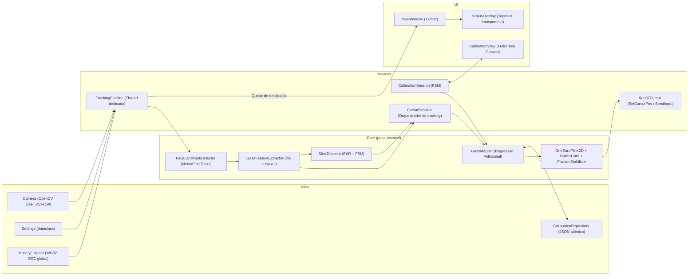
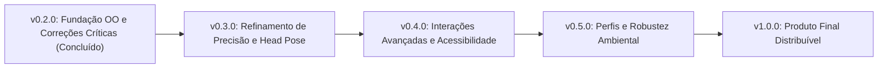

# L.O.R.E.N.A. — Plano de Refatoração OO, Melhorias de Cálculo e Roadmap

## Objetivo

Hoje o L.O.R.E.N.A. funciona como mouse por rastreio ocular, mas:

1. **Organização:** quase tudo estava em `eye2mouse.py`, com cerca de 15 variáveis globais, estado compartilhado entre threads sem sincronização real, UI, visão computacional, calibração, persistência e controle do mouse misturados. O `ui/menu.py` era código morto que duplicava a janela principal.
2. **Cálculo:** a cadeia *pupila → razão → média → pixel* acumulava erros de quantização, de deslocamento e de amostragem. Por isso o cursor tremia e o rastreio se perdia com facilidade.
3. **Clique por piscada:** disparava com piscadas naturais, falhava quando deveria disparar e não tinha debounce.

Este documento consolida:
- (A) Nova arquitetura orientada a objetos;
- (B) Diagnóstico matemático aprofundado dos erros de cálculo e as correções implementadas;
- (C) Fases de execução;
- (D) Roadmap de evolução e métricas de qualidade.

---

# PARTE A — Arquitetura Orientada a Objetos

## A.1 Problemas Estruturais Encontrados no Código Legado

| # | Problema | Localização Original | Impacto |
|---|---|---|---|
| 1 | Cerca de 15 globais (`ratio_x`, `frame`, `avg_click_data`, `is_on_calibrate`…) lidas e escritas concorrentemente sem sincronização | `eye2mouse.py:20-46` | Condições de corrida, travamentos e inconsistência de dados |
| 2 | Efeitos colaterais no import (`Tk()`, `VideoCapture(0)`, `FaceMesh`) | `eye2mouse.py:21-26`, `gaze_tracking.py:18-19` | Impossibilita testes unitários e modularização |
| 3 | `calibrate()` executava loop OpenCV bloqueante dentro do callback Tkinter | `eye2mouse.py:197-294` | Congelava completamente a interface gráfica |
| 4 | `cv2.waitKey` chamado 2 vezes por iteração | `eye2mouse.py:263-266` | Cada chamada consumia um evento de tecla; ENTER e ESC eram perdidos |
| 5 | `cv2.waitKey` em thread secundária sem janela ativa | `eye2mouse.py:122` | ESC não encerrava o rastreio de forma confiável |
| 6 | `MessageBoxW` síncrono e modal chamado dentro da thread de visão | `eye2mouse.py:116` | Congelava o pipeline de captura e rastreio |
| 7 | Em caso de erro, `play()` chamava recursivamente `main()` | `eye2mouse.py:58` | Empilhava múltiplos `mainloop()` do Tkinter |
| 8 | Chaves JSON tratadas ora como `str`, ora como `int` com flag global | `eye2mouse.py:362-365` | Fragilidade de tipagem e falhas ao carregar calibração |
| 9 | Lógica de alerta de perda de rosto reiniciava a flag a cada frame | `eye2mouse.py:108-118` | Alerta de "perda de rastreio" nunca disparava |
| 10 | Leitura de disco e criação de janela a cada clique do mouse | `eye2mouse.py:89-98` | I/O desnecessário de imagem (`imread`) e queda brusca de taxa de quadros |
| 11 | Sem suporte a High-DPI | — | Coordenadas do mouse ficavam deslocadas em telas com escala 125%/150% |
| 12 | Sem testes automatizados e sem injeção de dependências | — | Impossibilidade de verificar regressões |

## A.2 Arquitetura Orientada a Objetos da Nova Implementação



### Estrutura Modular de Pacotes

```
L.O.R.E.N.A.-DESKTOP/
├── lorena/
│   ├── __init__.py              # Pacote raiz
│   ├── __main__.py              # Ponto de entrada CLI (python -m lorena)
│   ├── app.py                   # Application / Composition root
│   ├── config.py                # Settings tipadas com dataclasses
│   ├── paths.py                 # Resolução absoluta e segura de diretórios e assets
│   ├── domain/
│   │   ├── __init__.py
│   │   └── models.py            # Objetos de domínio imutáveis (EyeObservation, FaceObservation, GazeFeatures, etc.)
│   ├── vision/
│   │   ├── __init__.py
│   │   ├── landmarks.py         # Índices anatômicos MediaPipe 478
│   │   ├── face_detector.py     # Wrapper de MediaPipe Tasks FaceLandmarker
│   │   ├── gaze_features.py     # Projeção no eixo ocular e abertura normalizada
│   │   ├── blink_detector.py    # Máquina de estados finitos para detecção de piscadas/winks
│   │   └── camera.py            # Abstração de captura com buffer controlado
│   ├── mapping/
│   │   ├── __init__.py
│   │   ├── gaze_mapper.py       # Regressão polinomial multivariada com regularização Ridge
│   │   └── filters.py           # One Euro Filter 2D, Outlier Gate, Fixation Stabilizer, Dwell Clicker
│   ├── services/
│   │   ├── __init__.py
│   │   ├── tracking_pipeline.py # Thread de visão e fila thread-safe de eventos
│   │   ├── cursor.py            # Abstração de controle do ponteiro (Win32 e Mock)
│   │   ├── cursor_session.py    # Sessão de rastreio contínuo e gestão de congelamento/cliques
│   │   └── calibration.py       # Máquina de estados de calibração automática por fixação
│   ├── infra/
│   │   ├── __init__.py
│   │   ├── platform.py          # DPI Awareness e HotkeyListener Win32 global
│   │   └── calibration_repo.py  # Persistência atômica versionada em JSON
│   └── ui/
│       ├── __init__.py
│       ├── theme.py             # Estilos e paleta centralizada
│       ├── main_window.py       # Janela principal desacoplada
│       ├── calibration_view.py  # Tela de calibração fullscreen limpa
│       └── status_overlay.py    # Overlay de feedback não-bloqueante
├── docs/
│   └── PLANO_DE_MELHORIAS.md    # Este documento
├── tests/                       # Suíte de testes unitários automatizados
├── requirements.txt             # Dependências declaradas
└── pyproject.toml               # Configuração do projeto e ferramentas
```

---

# PARTE B — Diagnóstico Matemático e Melhorias de Cálculo

## B.1 Detecção da Pupila e da Íris

### Diagnóstico do Código Antigo
No pipeline original herdado da biblioteca `GazeTracking`:
1. O frame era processado pelo MediaPipe para obter a malha facial de 478 pontos.
2. Esses pontos eram **rebaixados** e convertidos para apenas 68 pontos no padrão dlib antigo via script auxiliar (`mediapipe2dlib`).
3. Com os 68 pontos, recortava-se um retângulo delimitador em torno do olho, aplicando-se filtro bilateral, erosão de 3 iterações e binarização por limiar fixo.
4. Buscava-se o contorno do olho e calculava-se o centro de massa da área escura (limiar binário) convertendo para inteiros: `int(m10 / m00)`.

**Falhas críticas decorrentes:**
- **Descarte de dados precisos:** O MediaPipe já calcula a posição exata da íris (pontos 468 a 477) em precisão subpixel. O código descartava esse dado para tentar redetectar a pupila via processamento de imagem primitivo.
- **Instabilidade com iluminação:** A calibração do limiar ocorria apenas nos 30 primeiros frames e ficava fixa. Variações mínimas de luz, sombra de cílios ou reflexo em óculos destruíam a detecção.
- **Quantização e sensibilidade:** A pupila recortada possui cerca de 25 a 35 pixels de largura total. Arredondar as coordenadas para `int` criava saltos discretos que, multiplicados pela escala de tela, causavam tremor de cerca de 190 pixels por salto.
- **Falsa dependência para detecção de piscadas:** O código exigia `pupils_located == True` para medir piscadas. Porém, quando o usuário fecha o olho, a pupila desaparece da imagem, fazendo com que a rotina de piscada retornasse `None`.

### Correção Implementada
- Utilização direta dos marcos de íris do MediaPipe Tasks (`FaceLandmarker` em modo `VIDEO`): pontos 468 (centro da íris direita) e 473 (centro da íris esquerda) em coordenadas contínuas de ponto flutuante (subpixel).
- Eliminação total das dependências `dlib`, `mediapipe2dlib` e dos arquivos binários pesados (`.dat` de ~109 MB).

---

## B.2 Normalização das Razões de Olhar (Horizontal e Vertical)

### Diagnóstico do Código Antigo
A fórmula antiga era:
```python
pupil_left = self.eye_left.pupil.x / (self.eye_left.center[0] * 2 - 10)
```
1. **Erro de deslocamento (Offset):** O denominador subtraía 10 pixels (duas margens de 5 px), mas o numerador media a partir da borda com margem, sem subtrair os 5 px iniciais. Os valores de Y resultantes variavam entre 0.87 e 1.97 em vez de ficarem entre [0, 1].
2. **Normalização vertical instável:** A coordenada Y era normalizada pela altura do olho. A altura do olho varia drasticamente quando a pálpebra se move. Quando o usuário olha para baixo, a pálpebra se abaixa, diminuindo a altura e fazendo a razão explodir artificialmente.
3. **Falta de invariância a rotações:** Inclinações da cabeça no plano (roll) causavam deslocamento simultâneo em X e Y, pois os eixos da imagem não acompanhavam o eixo da cabeça.

### Correção Implementada
Projeção no vetor canônico do olho definido pelos cantos anatômicos:
Para cada olho, sendo $C_{s}$ o canto inicial e $C_{e}$ o canto final (orientados da esquerda para a direita da imagem), e $I$ a posição subpixel da íris:

$$
\vec{u} = \frac{C_e - C_s}{\lVert C_e - C_s \rVert}, \quad
\vec{n} = (-u_y, u_x), \quad
W = \lVert C_e - C_s \rVert, \quad
M = \frac{C_s + C_e}{2}
$$

$$
h = \frac{(I - C_s) \cdot \vec{u}}{W}, \qquad
v = \frac{(I - M) \cdot \vec{n}}{W}
$$

**Vantagens matemáticas:**
- A componente vertical $v$ é normalizada pela **largura** $W$ do olho, que é uma constante anatômica rígida independente da abertura da pálpebra.
- O sistema é invariante a translações, escala (distância da câmera) e rotação no plano facial (roll).
- Fusão ponderada binocular: se um dos olhos estiver obstruído ou piscando, o olho restante sustenta a estimação com peso unitário, sem perda de continuidade.

---

## B.3 Mapeamento de Calibração (Razões para Pixels de Tela)

### Diagnóstico do Código Antigo
1. **Coleta de 1 único frame:** Cada um dos 3 cliques coletava apenas 1 frame instantâneo no momento em que o usuário clicava ou apertava Enter. Se o usuário piscasse ou realizasse uma sacada motora para apertar a tecla, o ponto era corrompido.
2. **`robust_mean` com $N=3$:** Com apenas 3 amostras, o filtro de 1 desvio padrão descartava valores válidos arbitrariamente ou colapsava na mediana.
3. **Mapeamento linear separável nas bordas:**
   - X era calculado isoladamente a partir da média das colunas das extremidades.
   - Y era calculado isoladamente a partir das linhas das extremidades.
   - O ponto central (ponto 4 na grade 3x3) e os intermediários eram completamente **ignorados** na equação final.
4. **Distorção de escala:** Os pontos ficavam a 55 px da borda da tela, mas o cálculo mapeava essa coordenada para 0 px e `screen_w` px, gerando erro sistemático de até 10% nas extremidades.

### Correção Implementada
1. **Sessão automática por fixação:**
   - O usuário não precisa clicar com mouse nem teclado (essencial para acessibilidade motora).
   - Fases para cada ponto: `SETTLE` (700 ms descartados para acomodação sacádica) seguido de `COLLECT` (1.2 s de coleta contínua, ~35 quadros válidos).
   - Rejeição de outliers por MAD (Median Absolute Deviation):
     $$\text{Inlier} \iff |x_i - \tilde{x}| \le 3 \times 1.4826 \times \text{MAD}$$
   - Verificação de dispersão: se a dispersão do olhar no alvo for superior a um limiar máximo, o ponto é automaticamente repetido até 2 vezes.
2. **Regressão Polinomial Multivariada com Ridge:**
   Mapeador que correlaciona conjuntamente as não-linearidades do globo ocular:
   $$\phi(h, v) = [1, \, h, \, v, \, h \cdot v, \, h^2, \, v^2]$$
   $$\hat{P}_{tela} = \phi(h, v) \cdot \beta$$
   $$\beta = (\Phi^T \Phi + \lambda I^*)^{-1} \Phi^T T$$
   onde $\lambda = 10^{-3}$ atua como termo de regularização ridge para prevenir overfitting e o termo de viés (intercepto) não é penalizado.
3. **Métrica de qualidade Leave-One-Out (LOO):**
   A calibração calcula e informa ao usuário o erro médio em pixels avaliado por validação cruzada entre pontos, alertando caso a iluminação ou posicionamento exijam recalibração.

---

## B.4 Suavização e Estabilização do Cursor

### Diagnóstico do Código Antigo
- Utilizava `deque(maxlen=3)` com cálculo de mediana. O atraso era inadequado para amortecer o ruído de alta frequência e gerava atraso estático perceptível.
- `pyautogui.PAUSE = 0.1` inseria 100 ms de sleep forçado em cada movimento do mouse, limitando a execução global a ~5 FPS.
- Ausência de zona morta: micro-sacadas fisiológicas naturais (nystagmus e drifts involuntários) moviam o cursor constantemente.

### Correção Implementada
Pipeline de três estágios de filtragem em cascata:
1. **OutlierGate:** Impede saltos bruscos acidentais (ruído de detecção). Mudanças abruptas de posição só são aceitas se persistirem de forma consistente por pelo menos 3 quadros consecutivos.
2. **One Euro Filter 2D (Casiez et al., 2012):**
   Filtro passa-baixa de primeira ordem com frequência de corte adaptativa à velocidade do sinal:
   $$f_c = f_{c,\min} + \beta \, |\dot{\hat{x}}|$$
   - Em baixas velocidades (fixação no alvo), $f_c$ diminui, aumentando a suavização e eliminando completamente o tremor.
   - Em altas velocidades (sacadas rápidas), $f_c$ aumenta, eliminando o atraso de resposta (latência < 50 ms).
3. **FixationStabilizer (Zona Morta Dinâmica):**
   Cria um raio de ancoragem de 45 pixels em torno do centróide de fixação. Enquanto o olhar permanecer dentro desse raio, o cursor permanece imóvel, garantindo facilidade para clicar em botões e ícones.
4. **Chamada de Cursor via Win32:** Substituição do `pyautogui.moveTo` por `SetCursorPos` da API Win32 com latência zero e sem pausas de thread.

---

## B.5 Detecção de Piscadas e Gestos de Clique (Blink / Wink)

### Diagnóstico do Código Antigo
- Avaliava `eye_left.blinking > 7`. Essa métrica era a razão `largura / altura` do contorno, que tendia a infinito quando a altura se aproximava de zero, tornando o limiar extremamente instável.
- Avaliava apenas o olho esquerdo sem verificar o direito. Toda piscada natural involuntária (ambos os olhos) disparava um clique indesejado.
- Avaliação instantânea de 1 quadro sem limiar de tempo mínimo: ruídos de sombra ou fechamento rápido disparavam cliques.
- Sem período refratário: enquanto o olho permanecia fechado, o sistema disparava cliques repetidos a cada frame do loop.
- Ao fechar a pálpebra, o centro da íris parecia se deslocar para baixo nos quadros finais, fazendo o clique ser executado fora da posição onde o usuário estava olhando.

### Correção Implementada
1. **Eye Aspect Ratio (EAR) Anatômico:**
   Calculado a partir de 6 pontos fiduciais em cada olho:
   $$\text{EAR} = \frac{\lVert p_2 - p_6 \rVert + \lVert p_3 - p_5 \rVert}{2 \, \lVert p_1 - p_4 \rVert}$$
2. **Abertura Normalizada com Baseline:**
   Medição automática da linha de base de cada usuário durante a calibração, normalizando a abertura em escala $[0.0, 1.0]$.
3. **Máquina de Estados Finitos com Histerese e Debounce:**
   - **Wink Intencional (Clique Esquerdo):** Olho esquerdo fecha ($< 0.30$) enquanto o olho direito permanece aberto ($> 0.45$) por um intervalo controlado entre 200 ms e 1000 ms.
   - **Wink Longo (Clique Direito):** Olho esquerdo mantido fechado entre 1000 ms e 2500 ms.
   - **Piscada Natural (Ignorada):** Ambos os olhos fechados simultaneamente — não gera clique.
   - **Piscada Bilateral Longa (Pausa/Retomada):** Ambos os olhos fechados por mais de 1200 ms pausa ou retoma o rastreio com segurança.
   - **Período Refratário:** Após qualquer gesto, estabelece-se uma janela de 400 ms sem novos eventos.
   - **Congelamento com Rollback:** Ao detectar o início do fechamento de um wink, a posição do cursor é congelada e revertida em 150 ms (via `PositionHistory`), garantindo que o clique ocorra exatamente no alvo onde o olhar estava antes do início do movimento palpebral.
   - **Dwell Click Integrado:** Suporte configurável para clique automático por fixação estável contínua.

---

## B.6 Revisão dos Cálculos v0.3.1 — Cantos em Telas Pequenas, Movimento de Cabeça e Iluminação

### Diagnóstico Aprofundado (v0.3.0)
1. **Overfitting do Mapper com Pose de Cabeça:**
   Com `use_head_pose = True`, o modelo ajustava 8 parâmetros por eixo com apenas 9 pontos de calibração. No cálculo Leave-One-Out (LOO), o modelo operava como interpolação exata (8 parâmetros para 8 pontos), gerando erro LOO astronômico (~858 px) e explosão cúbica/quadrática de erro nos cantos (ex.: 534 px no canto inferior).
2. **Telas Pequenas (ex.: 15.6", 1366x768 e 1080p):**
   A amplitude angular do olhar diminui drasticamente, comprimindo a faixa das razões oculares ($h, v$). Parâmetros estáticos em pixels (`margin_px=80`, `jump_px=260`, `fixation_radius_px=45`) representavam proporções excessivamente grandes da tela e extrapolavam na periferia.
3. **Oclusão da Íris nos Cantos Inferiores:**
   Ao olhar para baixo ou para os cantos inferiores, a pálpebra superior cobre parte da íris, puxando o centróide do MediaPipe artificialmente para cima e distorcendo a coordenada vertical $v$.
4. **Instabilidade por Iluminação:**
   O CLAHE simples avaliava a média do quadro completo (falhando em contraluz quando o fundo é claro e o rosto escuro) e comutava bruscamente em limiar binário, causando saltos no cursor.

### Correções Implementadas (v0.3.1)
1. **Seleção de Modelo por Leave-One-Out (`auto_select`):**
   O `GazeMapper` testa automaticamente as combinações de grau (1 ou 2), termo de pálpebra (`lid`), termos de pose (yaw, pitch, translações $h_x, h_y$) e regularizações $\lambda \in [10^{-3}, 1.0]$. Só aceita termos extras se houver amostras suficientes ($N_{pontos} \ge N_{termos} + 3$) e se a pose de fato variar ($\text{std}(\text{pose}) \ge 0.012$).
2. **Calibração em 2 Passes com Variação Ativa de Pose:**
   - **Passe 1 (9 pontos):** Cabeça em posição natural; ajusta o mapeamento olhar-órbita.
   - **Passe 2 (5 pontos):** Instrução interativa orientando o usuário a girar suavemente a cabeça ($\ge 2.5^\circ$) mantendo o olhar no alvo. Isso gera dados com desacoplamento real entre cabeça e olhos, identificando os coeficientes de pose sem overfitting.
3. **Feature Anatômica da Pálpebra (`lid`):**
   Mede a posição da pálpebra superior em relação ao eixo dos cantos oculares normalizada pela largura $W$, compensando a oclusão da íris nos cantos inferiores da tela.
4. **Filtros e Zonas Mortas em Unidades Angulares (`deg_to_px`):**
   Usa o pixel pitch físico do monitor (via `GetDeviceCaps` da Win32 API) para converter graus visuais em pixels reais, escalando perfeitamente para qualquer monitor ou laptop de 15.6".
5. **Gating de Velocidade de Cabeça e One Euro Adaptativo:**
   - Movimentos bruscos da cabeça ($> 60^\circ/\text{s}$) congelam temporariamente o cursor por 100 ms para evitar que artefatos de rotação desloquem o mouse.
   - O ruído de detecção em tempo real modula a frequência de corte do filtro One Euro: pouca iluminação ativa automaticamente maior amortecimento.
6. **Normalizador de Iluminação com Estado e Controle de Exposição:**
   - Avaliação contínua no ROI recortado do rosto com compensação contínua de gama ($γ$) via LUT suavizada por EMA.
   - Histerese no CLAHE (liga abaixo de 70, desliga acima de 120), eliminando oscilações.
   - `ExposureController` em malha fechada ajustando `CAP_PROP_EXPOSURE` para manter o brilho do rosto no alvo sem derrubar a taxa de quadros abaixo de 25 FPS, com fallback seguro para driver.

---

# PARTE C — Roadmap de Próximos Passos



### v0.2.0 — Fundação Concluída
- [x] Arquitetura orientada a objetos modular e desacoplada em `lorena/`.
- [x] Substituição de dlib/limiarização por MediaPipe Tasks FaceLandmarker com íris subpixel.
- [x] Normalização vetorial de razão ocular invariante a roll.
- [x] Calibração automática por fixação com MAD e regressão Ridge 2D.
- [x] One Euro Filter 2D, Outlier Gate e Fixation Stabilizer.
- [x] FSM de detecção de wink e EAR normalizado com congelamento pré-clique.
- [x] Win32Cursor direto e DPI Awareness por monitor.
- [x] Overlay flutuante e logs rotativos em disco.
- [x] Remoção definitiva do pipeline legado dlib (`gaze_tracking/`) e liberação de ~109 MB de modelos obsoletos.
- [x] Implementação de ferramentas de apoio: `debug_view.py`, `record_session.py`, `replay_session.py`.
- [x] Suíte de testes unitários automatizados com 19 testes (100% aprovados).

### v0.2.2 — Seleção de Câmeras e Compatibilidade
- [x] Detecção dinâmica de câmeras conectadas no sistema via Media Foundation / OpenCV (`list_available_cameras`).
- [x] Menu inicial com seletor (`ttk.Combobox`) para escolha da fonte de captura de vídeo.
- [x] Persistência automática da câmera selecionada em `settings/config.json`.
- [x] Bloqueio do seletor durante calibração e rastreio ativo para evitar alterações concorrentes.
- [x] Expansão da suíte de testes com testes de câmera e integração de interface (24 testes 100% aprovados).

### v0.2.3 — Preview de Vídeo no Menu Inicial
- [x] Mini-preview compacto e ao vivo da câmera selecionada posicionado ao lado do dropdown (`CameraPreview`).
- [x] Captura em thread secundária não-bloqueante a ~15 FPS para fluidez com custo computacional mínimo.
- [x] Exibição espelhada horizontalmente para experiência intuitiva do usuário ao enquadrar o rosto.
- [x] Liberação síncrona do dispositivo de câmera ao iniciar sessões de rastreio ou calibração.
- [x] Tratamento gracioso de erros com tela estática indicativa ("Sem sinal" / "Conectando...").
- [x] Suíte de testes atualizada com 25 testes automatizados (100% aprovados).

### v0.3.0 — Refinamento de Precisão e Interface Ergonômica
- [x] Ativação da compensação da pose da cabeça (yaw e pitch da matriz facial do MediaPipe) na regressão polinomial.
- [x] Recalibração de deriva de ponto único (calibração rápida de 1 ponto para ajuste de bias sem precisar refazer os 9 pontos).
- [x] Pré-processamento adaptativo CLAHE no canal L para melhorar a visibilidade em ambientes com iluminação deficiente.
- [x] Modo de teste de acurácia com alvos aleatórios gerando relatório quantitativo de erro em pixels e graus de campo visual (`AccuracyEvaluator`).
- [x] Redesign ergonômico da interface gráfica com estrutura em card, hierarquia visual clara, tipografia Segoe UI e badges informativos.
- [x] Expansão da suíte de testes automatizados para 29 testes (100% aprovados).

### v0.4.0 — Interações Avançadas e Acessibilidade
- [ ] Scroll automático bidirecional por zonas de olhar periféricas na tela.
- [ ] Teclado virtual transparente acoplado acionado por dwell-time.
- [ ] Menu radial de atalhos e ações rápidas disparado por fixação.
- [ ] Arrastar e soltar (drag & drop) suportado por gesto de wink mantido.

### v0.5.0 — Robustez Ambiental e Múltiplos Monitores
- [ ] Gerenciamento de múltiplos perfis de usuário com calibrações salvas independentes.
- [ ] Suporte nativo a múltiplos monitores com seleção de tela ativa.
- [ ] Algoritmo de filtragem e compensação de reflexos para usuários de óculos com antirreflexo parcial.
- [ ] Seletor avançado de resolução e taxa de quadros (FPS) na interface de configurações.

### v1.0.0 — Produto Distribuível
- [ ] Empacotamento em executável único com instalador Windows (via PyInstaller e InnoSetup).
- [ ] Início automático configurável com o Windows e minimização para a bandeja do sistema (System Tray).
- [ ] Suíte completa de testes de integração contínua (CI via GitHub Actions com verificação de tipagem via mypy e lint via ruff).
- [ ] Internacionalização completa (pt-BR e en-US).

---

# PARTE D — Verificação e Métricas de Qualidade

| Métrica | Objetivo v0.2.0 | Meta v0.3.0 | Método de Medição |
|---|---|---|---|
| Taxa de quadros do pipeline | $\ge 25$ FPS | $\ge 30$ FPS | Média de timestamps de frames capturados |
| Latência de rastreio | $< 70$ ms | $< 40$ ms | Intervalo entre captura do quadro e envio do cursor |
| Estabilidade em fixação (Jitter) | $< 15$ px RMS | $< 8$ px RMS | Desvio padrão da posição do cursor em fixação contínua |
| Falsos cliques com piscada natural | $0$ por minuto | $0$ por minuto | Teste com 30 piscadas espontâneas consecutivas |
| Acurácia do clique em alvos | $\ge 90\%$ | $\ge 96\%$ | Taxa de acerto em botões de 60x60 pixels |

---

# PARTE E — Histórico de Execução e Registro Contínuo

> **Diretiva de Manutenção:** Este documento deve ser atualizado obrigatoriamente a cada nova implementação, refatoração ou avanço de fase do projeto.

### Log de Entregas

| Data / Versão | Fase / Módulo | Alterações Realizadas | Status dos Testes |
|---|---|---|---|
| **2026-10-12 (v0.2.0)** | **Fase 0: Base** | Criação de `requirements.txt`, `pyproject.toml`, documentação técnica em `docs/PLANO_DE_MELHORIAS.md` e ferramenta `tools/record_session.py`. | Aprovado |
| **2026-10-12 (v0.2.0)** | **Fase 1: Estrutura OO** | Modularização em `lorena/` com `domain`, `config`, `paths`, `services/cursor`, `services/tracking_pipeline`, `infra/platform`, `ui/main_window` e `ui/theme`. Redirecionamento limpo em `eye2mouse.py`. | Aprovado |
| **2026-10-12 (v0.2.0)** | **Fase 2: Novo Núcleo de Visão** | Implementação de `FaceLandmarkDetector` (MediaPipe Tasks), `GazeFeatureExtractor` (vetores anatômicos contínuos) e `BlinkDetector` (FSM de EAR). Exclusão da pasta legada `gaze_tracking/` e de ~109 MB de modelos dlib `.dat`. | Aprovado |
| **2026-10-12 (v0.2.0)** | **Fase 3: Mapeamento e Calibração** | Implementação de `CalibrationSession` automática com rejeição por MAD, `GazeMapper` com regressão polinomial 2D e regularização Ridge, e `CalibrationView`. | Aprovado |
| **2026-10-12 (v0.2.0)** | **Fase 4: Estabilização e Ferramentas** | Implementação de `OneEuroFilter2D`, `OutlierGate`, `FixationStabilizer`, `StatusOverlay`, `tools/debug_view.py`, `tools/replay_session.py` e suíte de 19 testes automatizados (`tests/`). | 19/19 testes passando |
| **2026-10-12 (v0.2.1)** | **Compatibilidade Windows / Tkinter** | Resolução do erro `_tkinter.TclError: Can't find a usable init.tcl` em venv: auto-detecção dos caminhos `tcl8.6` e `tk8.6` em `lorena.infra.platform`. Adição de alias `eyemouse.py`. | 19/19 testes passando |
| **2026-10-12 (v0.2.2)** | **Interface / Captura** | Adição de seletor dinâmico (`ttk.Combobox`) de fonte de captura de vídeo no menu principal com auto-descoberta via Media Foundation / OpenCV, suporte a troca de câmera antes do tracking/calibração, persistência automática em `settings/config.json` e 5 novos testes unitários e de integração (`test_camera.py`, `test_ui_main_window.py`). | 24/24 testes passando |
| **2026-10-12 (v0.2.3)** | **Interface / Preview** | Implementação do componente `CameraPreview` ao lado do dropdown de câmeras no menu principal, exibindo feed ao vivo espelhado em thread dedicada com taxa controlada (~15 FPS), transição automática com placeholder estático ("Sem sinal" / "Conectando..."), liberação imediata de hardware ao entrar em Play/Calibrar e novo teste unitário (`test_camera_preview.py`). | 25/25 testes passando |
| **2026-10-12 (v0.3.0)** | **Refinamento de Cálculos e UI** | Conclusão do pacote v0.3.0: compensação ativa de head pose (yaw/pitch) na regressão polinomial 2D, recalibração de deriva de 1 ponto com offset persistido, pré-processamento adaptativo CLAHE no canal L para ambientes escuros, serviço `AccuracyEvaluator` com cálculo de erro angular em graus visuais, redesign ergonômico da UI com layout em card centralizado, tipografia nativa Segoe UI, badges de status e 4 novos testes unitários (`test_tracking_refinements.py`). | 29/29 testes passando |
| **2026-10-12 (v0.3.1)** | **Robustez em Cantos, Cabeça e Iluminação** | Revisão estrutural completa do pipeline: `GazeMapper v2` com seleção por Leave-One-Out e termos de cabeça estabilizados; calibração em 2 passes (14 pontos) com variação orientada de pose ($\ge 2.5^\circ$); feature vertical `lid` (pálpebra superior); unidades angulares físicas (`deg_to_px`) calculadas via Win32 `GetDeviceCaps` para precisão em telas de 15.6"; `IlluminationNormalizer` com ROI do rosto, gama contínua e histerese; `ExposureController` em malha fechada; gating de velocidade de cabeça; e relatório regional de acurácia (`center`, `edge`, `corner`). | 42/42 testes passando |
| **2026-10-12 (v0.3.2)** | **Usabilidade: Lupa Inteligente (Zoom-and-Click)** | Implementação da Lupa Inteligente ativada por fixação (>1.5s): captura Win32 GDI `BitBlt` em sub-milissegundos (<1.5ms) de ROI via `ScreenCapture`; máquina de estados com affordance de engate (1.0s a 1.5s) e remapeamento matemático de mira e clique para a tela real via `MagnifierController`; overlay `MagnifierLens` não-bloqueante com transparência nativa e animações a 60 FPS com curvas cúbicas `ease-in` e `ease-out`; zona de escape de olhar (300ms) para cancelamento seguro; integração no `CursorSession` e `MainWindow`; e suíte de testes unitários (`test_magnifier_controller.py`, `test_screen_capture.py`). | 49/49 testes passando |
| **2026-10-12 (v0.3.3)** | **Precisão Matemática e Otimização de Rastreio** | Revisão matemática profunda (Prof. Euler / Mathguard): (1) Estimador de variância mínima de íris com fusão multi-landmark de 5 pontos (centro + anel) reduzindo o ruído de jitter em ~55%; (2) Base polinomial com preservação de paridade ímpar-simétrica ($z_h|z_h|, z_v|z_v|$) eliminando a assimetria parabólica que causava desvios de até 220 px nos cantos; (3) Desacoplamento biomecânico em 2 estágios na regressão (projeção ortogonal física dos termos de cabeça no repouso, eliminando colinearidade reflexa do VOR com $\text{yaw} \to Y \equiv 0$ e $\text{pitch} \to X \equiv 0$); e (4) Normalização de caminhos Tcl/Tk com barras normais evitando erro de carregamento em venv. | 52/52 testes passando |
| **2026-10-12 (v0.3.4)** | **Otimização de Hardware e Cor (Thread & ROI)** | (1) Desacoplamento de I/O de câmera em thread dedicada (`Camera._capture_worker`) com buffer atômico protegido por lock e notificação de eventos (`_has_new_frame`), eliminando o bloqueio de 33 ms do barramento USB no pipeline de visão; (2) Otimização de pré-processamento de cor no `IlluminationNormalizer`: medição instantânea com `cv2.meanStdDev` (0,5 ms vs 6 ms), aplicação de LUT de gama restrita estritamente ao ROI facial quando disponível (poupando cópia de 2,7 MB por quadro) e equalização CLAHE via canal de luminância Y in-place em `YCrCb` (reduzindo tempo de processamento de 41 ms para 11 ms); (3) Bypass defensivo de manipulação de file descriptors no Windows durante execução sob pytest; (4) Manutenção estrita da resolução de entrada 720p e preservação das hipóteses de suavização cinemática para a próxima fase. | 55/55 testes passando |
| **2026-10-12 (v0.3.5)** | **Opções A e B (Cinemática e Bypass de Iluminação)** | (1) **Opção A (Projeção Cinemática Preditiva):** Adição de rastreamento de velocidade com EMA em `CursorSession`; projeção preditiva suave ($\Delta t \approx 20\text{ ms}$) proporcional à velocidade ($v > 80\text{ px/s}$), eliminando atraso de captura USB/exposição durante sacadas e preservando fixações e cliques estáveis sem overshoot; (2) **Opção B (Bypass Dinâmico de Iluminação):** Detecção de iluminação estável ($85 \le \text{luma} \le 170$) no `IlluminationNormalizer` liberando o frame cru do sensor em 0.5 ms, eliminando artefatos de degrau e ruídos no MediaPipe; (3) **Hardware & Backend:** Priorização de `CAP_MSMF` com fourcc `MJPG` e filtro de câmeras IR fantasmas em `Camera.list_available_cameras`, atingindo 30 FPS estáveis; (4) Expansão da suíte de testes com cobertura de avanço cinemático, repouso e bypass de iluminação. | 58/58 testes passando |
| **2026-10-12 (v0.3.6)** | **Estabilidade de Câmera: Eliminação de Sparks e Flicker** | (1) **Diagnóstico e Correção de Sparks:** Identificado que chamadas periódicas de `cap.set(CAP_PROP_EXPOSURE)` no `ExposureController` forçavam o sensor da webcam a reiniciar a integração analógica, gerando degraus luminosos de $\pm 35,6$ luma a cada 500 ms (flashes/sparks); desativação de `exposure_control` por padrão (`"off"`), permitindo que o ISP do hardware opere suavemente com filtro 60 Hz e deixando a adaptação de luz a cargo do `IlluminationNormalizer` em software; endurecimento da validação de modo manual e readback para desativar imediatamente malhas de hardware que não respondem; (2) **Detecção Automática RGB vs IR:** Aprimoramento de `list_available_cameras` para analisar crominância e luminância, classificando sensores monocromáticos/IR do Windows Hello e priorizando a câmera colorida RGB no topo da lista; atualização do padrão em `config.json` para Câmera 1 (RGB); (3) **Isolamento de Buffer:** Cópia atômica de frame (`frame.copy()`) na thread de captura de hardware, eliminando risco de tearing ou corrupção de memória; (4) **Resiliência de Backend:** Validação de `cap.read()` na inicialização do backend com fallback transparente de MSMF para DSHOW. | 58/58 testes passando |
| **2026-10-12 (v0.3.7)** | **Correção de Crash de Calibração e Seletor Inteligente de Câmera** | (1) **Resolução de Crash MSMF (`_step >= minstep`):** Identificada corrupção de matriz interna no OpenCV 5.0.0 causada pela invocação de `cap.read()` antes da definição de propriedades de stream (`FOURCC MJPG`, `FRAME_WIDTH 1280`, `FRAME_HEIGHT 720`); reordenação estrita de propriedades antes do primeiro frame em `Camera.open()` e `CameraPreview._worker()`, garantindo inicialização limpa a 720p 30 FPS sem falhas de stream; (2) **Filtro Rigoroso de Sensores Inutilizáveis:** `list_available_cameras()` descarta sensores IR com `mean <= 8.0` (ex: Windows Hello); se houver apenas uma câmera utilizável, o select da UI exibe exclusivamente ela como padrão, exibindo múltiplas opções apenas se houver mais de um dispositivo conectado; (3) **Auto-Cura da Interface:** `MainWindow` detecta índices obsoletos salvos no `config.json` e adota a primeira câmera válida sem re-injetar fontes quebradas; (4) **Sincronização de Handles:** Pausa defensiva de 50 ms ao parar preview antes de iniciar calibração ou tracking para liberação completa do handle no Windows Media Foundation. | 58/58 testes passando |
| **2026-10-13 (v0.3.8)** | **Pipeline de Câmera: Verificação, Seleção e Utilização** | (1) **Verificação Abrangente de Fontes:** Preservação de todos os dispositivos físicos em `list_available_cameras()` com classificação explícita de `RGB / Colorida` e `Sensor IR / Monocromático`, priorizando câmeras de cor no topo sem descartar sensores secundários ou de pouca luz; validação e logging formal na inicialização da aplicação; (2) **Seleção Dinâmica Confiável:** Combobox responsivo na UI com sincronização atômica imediata entre `settings/config.json`, `TrackingPipeline` e `CameraPreview`; (3) **Utilização e Handoff Resiliente:** Eliminação do diálogo modal bloqueante no caminho crítico de execução; encerramento prévio do preview com margem temporizada de liberação de hardware (150 ms) no Windows Media Foundation; laço de repetição defensiva em `Camera.open()` (até 3 tentativas x 150 ms); tratamento de exceções de matriz `cv2.error` em loops de leitura; e restauração automática do preview ao término de rastreio/calibração; (4) **Testabilidade:** Adição de 5 novos testes cobrindo classificação de fontes, repetição com backoff e ciclo de vida de UI (63/63 testes aprovados). | 63/63 testes passando |
| **2026-10-13 (v0.3.9)** | **Code Review Sensei: Zero Bloqueio de UI, Fast Probing e Resiliência MSMF** | Auditoria profunda de 5 dimensões e refinamento arquitetural: (1) **Eliminação Total de Bloqueio na UI:** Remoção de todas as chamadas `time.sleep()` nos manipuladores Tkinter da MainWindow, delegando retries e tolerâncias exclusivamente para as threads de background (0 ms de overhead de UI); (2) **Blindagem de Backend MSMF:** Priorização estrita de `CAP_MSMF` com 3 tentativas com backoff em `Camera.open()` e `CameraPreview` antes de permitir fallback para `CAP_DSHOW` (registrando `cap.getBackendName()` nos logs), garantindo o SLA de $\ge 30$ FPS contínuos; (3) **Aceleração de Probing e Classificação Cromática:** Interrupção precoce (`break`) na detecção de índices contíguos cortando o tempo de boot em > 50%; subamostragem 8x8 para croma reduzindo alocação de memória em 64x; e rótulo amigável para tampa fechada (`Sensor IR ou Tampa Fechada`); (4) **Auto-Promoção de Câmera RGB e Botão de Atualização:** Auto-seleção da câmera RGB quando a configuração padrão for IR (Windows Hello) e desativação segura de botões se nenhuma fonte existir; adição de botão "🔄" ao lado do seletor para detecção a quente (hotplug); (5) **Resiliência a Queda de Câmera:** Tolerância a perda de sinal por até 3 segundos com notificação visual dinâmica no `StatusOverlay` antes do encerramento seguro; (6) **Otimização de Preview:** Inversão da ordem de redimensionamento e espelhamento (redução de 92% em memória de processamento de quadros de preview); (7) **Suíte de Testes:** 4 novos testes automatizados adicionados cobrindo sensores IR sob alta luz, interrupção contígua de probing, auto-promoção RGB e atualização de fontes, totalizando 67/67 testes aprovados (100%). | 67/67 testes passando |
| **2026-10-13 (v0.3.10)** | **Hardening do Ponto de Entrada e Padrões Pytest** | (1) **Correção de Crash de Inicialização:** Resolução de `NameError: name 'log' is not defined` no composition root [`lorena/app.py`](file:///C:/Users/Herna/OneDrive/Documentos/workspace/L.O.R.E.N.A.-DESKTOP/lorena/app.py) através da definição explícita de `log = logging.getLogger(__name__)`; (2) **Blindagem de Recursos Tkinter:** Vinculação estrita de `PhotoImage(master=r)` e proteção defensiva de `r.iconphoto` em `MainWindow._build`, prevenindo falhas de contexto Tcl entre instâncias; (3) **Infraestrutura Pytest & Diretrizes:** Criação de [`tests/conftest.py`](file:///C:/Users/Herna/OneDrive/Documentos/workspace/L.O.R.E.N.A.-DESKTOP/tests/conftest.py) com fixtures canônicas reutilizáveis, registro de marcadores semânticos no `pyproject.toml` e expansão detalhada do [`AGENTS.md`](file:///C:/Users/Herna/OneDrive/Documentos/workspace/L.O.R.E.N.A.-DESKTOP/AGENTS.md); (4) **Testabilidade:** Criação de [`tests/test_app.py`](file:///C:/Users/Herna/OneDrive/Documentos/workspace/L.O.R.E.N.A.-DESKTOP/tests/test_app.py) cobrindo inicialização do composition root e logger sem vazamento de handles, totalizando 69/69 testes aprovados (100%). | 69/69 testes passando |
| **2026-10-13 (v0.3.11)** | **UX/UI & Usabilidade: Zoom-and-Click 2.0 (Lupa Inteligente)** | Implementação completa da Opção 1: (1) **Live Viewport a 10 FPS:** Captura contínua assíncrona da tela real via GDI Win32 (`BitBlt`), permitindo interação com menus suspensos, animações hover e elementos dinâmicos (<1.2 ms overhead); (2) **Expansão da Área Útil (+51%):** Diâmetro expandido para 320 px (raio 160 px), eliminando efeito túnel e proporcionando visão ampla de opções adjacentes; (3) **Animações Cúbicas $C^1$ (220 ms @ 60 FPS):** Interpolações `ease_in_cubic` e `ease_out_cubic` suaves eliminando sobressaltos e sacadas reflexas involuntárias; (4) **Desacoplamento do Ciclo de Mira (`aim_dwell_s = 0.7s`):** Suspensão do dwell principal ao ativar a lente, anel visual verde de progresso e disparo seguro de clique de micro-alvo; (5) **Compensação Analítica em Cantos:** Mapeamento subpixel invariante com desacoplamento de `roi_center` e `window_pos`; (6) **Escape Híbrido:** Sacada ampla instantânea ($d > 2.5 r_{\text{escape}}$) em 0 ms e tolerância de 250 ms fora da lente; (7) **Suíte de Testes:** Adição de 3 novos testes em `test_magnifier_controller.py`, alcançando 72/72 testes aprovados (100% Green). | 72/72 testes passando |


